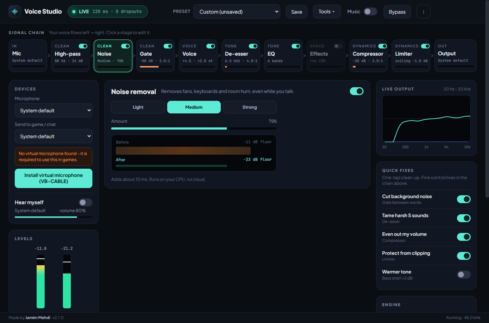
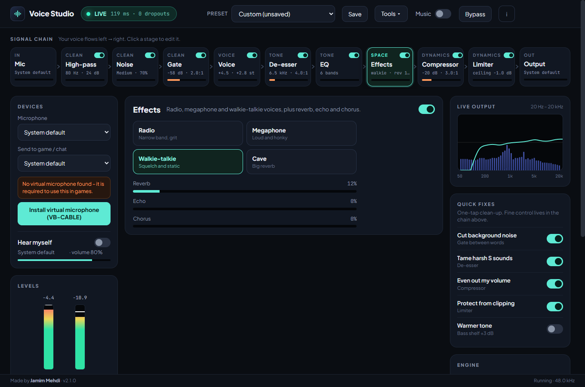
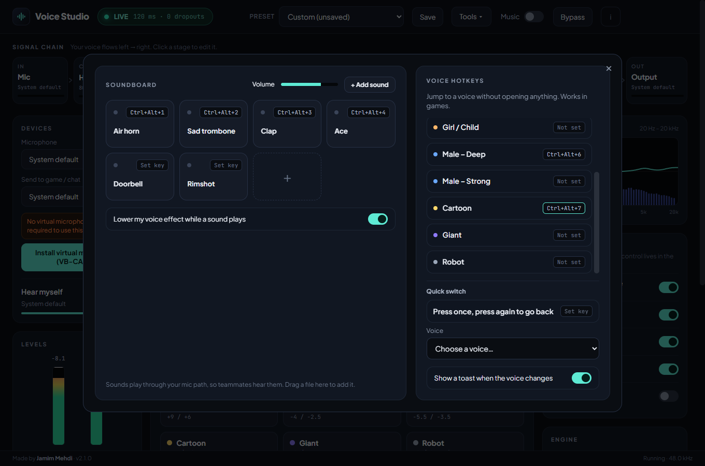
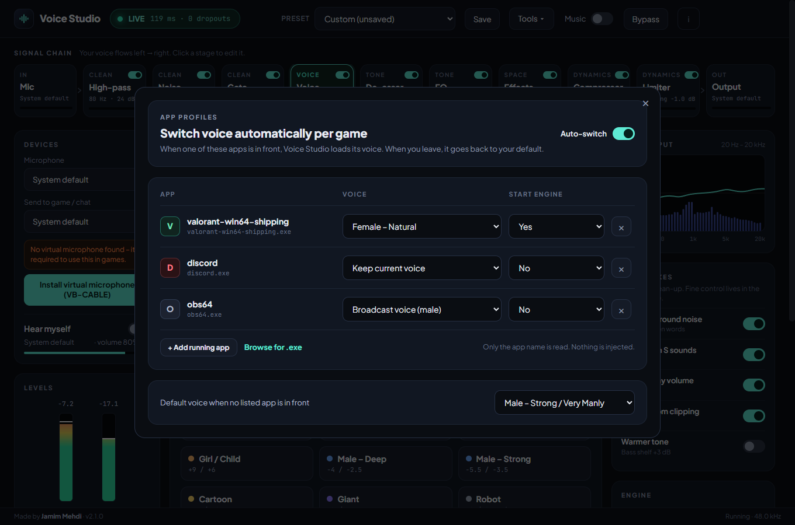
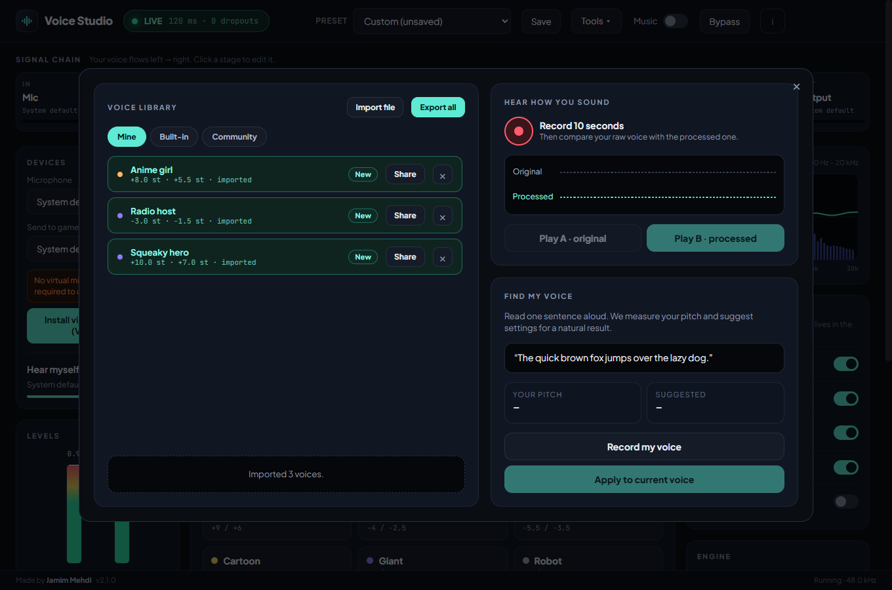
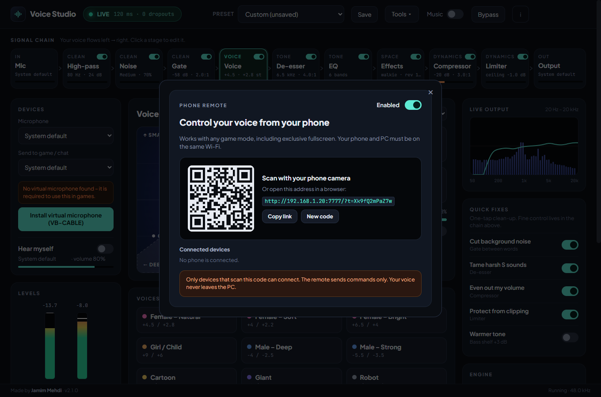
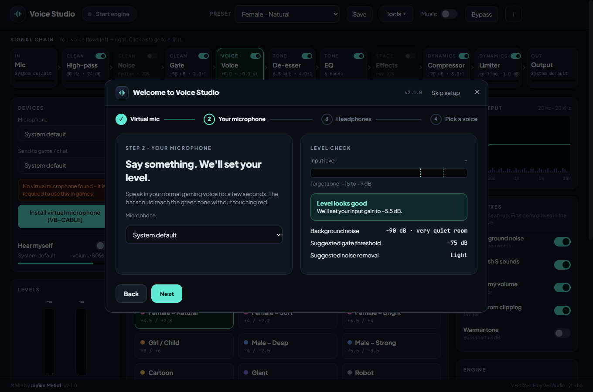
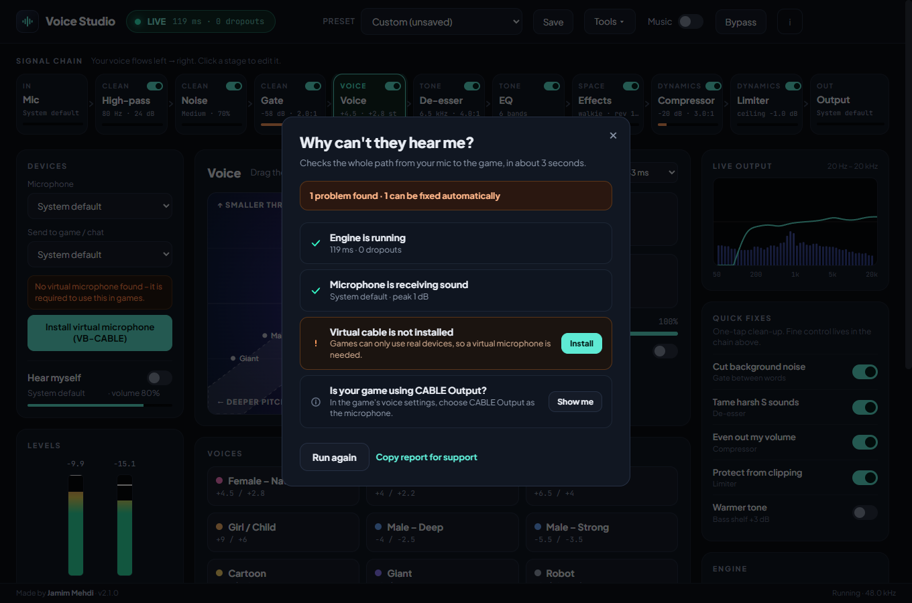
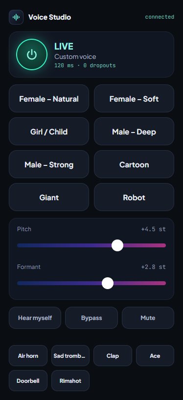

<p align="center"></p>
<h1 align="center">Voice Studio</h1>
<p align="center">
  Real-time voice changer and vocal studio for Windows.<br>
  Female, male and cartoon voices, routed live into Valorant, Discord and OBS.
</p>
<p align="center">
  <a href="https://github.com/jamimmehdi/voice-studio/releases/latest"><b>Download</b></a> ·
  <a href="https://jamimmehdi.github.io/voice-studio/">Website</a> ·
  <a href="#game-and-app-setup">Game setup</a> ·
  <a href="#troubleshooting">Troubleshooting</a>
</p>

<p align="center"></p>

**Designed and developed by [Jamim Mehdi](https://github.com/jamimmehdi).**

## Contents

[Features](#features) · [Install](#install) · [Game and app setup](#game-and-app-setup) · [Compact mode](#compact-mode) ·
[Music player](#music-player) · [Soundboard and hotkeys](#soundboard-and-hotkeys) · [App profiles](#app-profiles) ·
[Voice library](#voice-library) · [Phone remote](#phone-remote) · [Troubleshooting](#troubleshooting) ·
[Architecture](#architecture) · [Develop](#develop)

## Features

|                                  |                                                                                                                                                                                     |
| -------------------------------- | ----------------------------------------------------------------------------------------------------------------------------------------------------------------------------------- |
| **Voice pad**                    | One draggable dot moves between male, female and cartoon voices. Pitch and formant are independent (phase vocoder with cepstral formant control).                                   |
| **Ten built-in voices**          | Female natural / soft / bright, Girl, Male deep / strong, Cartoon, Giant, Robot, Broadcast. Save your own presets.                                                                  |
| **Studio chain**                 | High-pass, noise removal, downward expander (gate), split-band de-esser, 6-band parametric EQ with a draggable curve, effects, compressor, look-ahead limiter, input / output gain. |
| **Noise removal**                | Removes fans, keyboards and room hum even while you talk. Three strengths and a fine slider, about 10 ms, no model download.                                                        |
| **Effects**                      | Radio, megaphone, walkie-talkie and cave characters plus reverb, echo and chorus.                                                                                                   |
| **Voice models**                 | Fast (about 11 ms), Clean (43 ms, default) and Studio (85 ms). **Auto buffer** raises the audio buffer by itself if audio starts to drop out.                                       |
| **Music through the mic**        | Local files, playlist or a link. Ducks while you talk. Teammates hear it.                                                                                                           |
| **Soundboard and hotkeys**       | Pads with their own keys, plus a global hotkey per voice and a quick-switch key.                                                                                                    |
| **App profiles**                 | The voice follows the program in front: Valorant gets one voice, Discord another.                                                                                                   |
| **Voice library**                | Import, export and share `.vsp` voices, community voices, a 10-second A/B test and "Find my voice".                                                                                 |
| **Phone remote**                 | Control Voice Studio from your phone, in any game mode, including exclusive fullscreen.                                                                                             |
| **Setup wizard and diagnostics** | First-run wizard for the virtual mic, microphone level and headphones, plus a one-click "Why can't they hear me?" check.                                                            |
| **Compact mode**                 | Tray icon, global shortcut (default `Ctrl+Alt+V`), an always-on-top panel that never steals focus, and a floating icon.                                                             |
| **Live scope and meters**        | Spectrum, level meters and a gain-reduction meter per dynamics stage.                                                                                                               |
| **Recorder**                     | Saves a WAV of exactly what your teammates hear.                                                                                                                                    |
| **Auto-updates**                 | Checks GitHub Releases on launch; one click installs.                                                                                                                               |
| **One-click virtual mic**        | Downloads and starts the official VB-CABLE installer, after verifying its signature.                                                                                                |

### Screenshots

| Noise removal – with a live before / after                               | Effects – radio, megaphone, walkie-talkie, cave                      |
| ------------------------------------------------------------------------ | -------------------------------------------------------------------- |
|  |  |

| EQ – drag bands on the spectrum                            | Compressor – with gain-reduction meter                                     |
| ---------------------------------------------------------- | -------------------------------------------------------------------------- |
|  |  |

| Soundboard and voice hotkeys                                  | App profiles                                                  |
| ------------------------------------------------------------- | ------------------------------------------------------------- |
|  |  |

| Voice library, A/B test, find my voice                        | Phone remote                                                |
| ------------------------------------------------------------- | ----------------------------------------------------------- |
|  |  |

| Setup wizard                                               | Why can't they hear me?                                      |
| ---------------------------------------------------------- | ------------------------------------------------------------ |
|  |  |

| Compact panel                                                             | Floating icon                                                         | The phone page                                                       | Launch screen                                                     |
| ------------------------------------------------------------------------- | --------------------------------------------------------------------- | -------------------------------------------------------------------- | ----------------------------------------------------------------- |
|  |  |  |  |

## Install

1. Download `Voice-Studio-Setup-x.y.z.exe` from the [latest release](https://github.com/jamimmehdi/voice-studio/releases/latest) and run it.
   Windows SmartScreen may warn about an "unknown publisher" because the installer is not code-signed. Choose **More info → Run anyway**.
2. Games can only use real input devices, so you need a virtual microphone. If none is found, click
   **Install virtual microphone (VB-CABLE)** in the Devices card. It downloads the official package from vb-audio.com,
   checks its signature and starts VB-Audio's installer. Click **Install Driver**, then **restart your PC**.
3. In Voice Studio set **Send to game / chat** to **`CABLE Input`**, click **Start engine** and pick a voice.
4. In your game or chat app choose **`CABLE Output (VB-Audio Virtual Cable)`** as the microphone (see below).

```
Your mic  →  Voice Studio  →  CABLE Input  →  CABLE Output  →  Game / Discord / OBS
```

VB-CABLE is donationware by VB-Audio (<https://vb-audio.com/Cable/>). Its licence does not allow bundling it inside
another installer, so it is **not** included – the app only downloads it from the official site on request.

To hear yourself, turn on **Hear myself** and pick your **headphones** as the monitor device. Don't monitor through speakers: the mic will pick them up.

## Game and app setup

Pick **`CABLE Output (VB-Audio Virtual Cable)`** as the input device. Menu names vary between game versions; if you
can't find the option, search the settings for "microphone" or "voice".

### Valorant

1. Voice Studio: output **CABLE Input**, **Start engine**.
2. Valorant: **Settings → Audio → Voice Chat → Input Device** → `CABLE Output (VB-Audio Virtual Cable)`.
3. Use the in-game voice test to confirm you hear the changed voice.

Voice Studio is a plain audio device. It never injects into the game or touches its memory, so Vanguard sees nothing unusual.

### Discord

1. **User Settings → Voice & Video → Input Device** → `CABLE Output (VB-Audio Virtual Cable)`.
2. Switch Discord's **Noise Suppression**, **Echo Cancellation** and **Automatic Gain Control** off – Voice Studio already cleans and levels the signal, and doing it twice smears the voice.
3. Leave **Automatic Input Sensitivity** on.

### CS2, Apex Legends, Fortnite, Call of Duty and similar

Open the game's **Audio / Voice chat** settings and set the **Microphone** or **Voice input device** to `CABLE Output`.
If the game has no device picker it follows the Windows default recording device – use the Windows method below.

### OBS, Streamlabs and streaming

1. Add an **Audio Input Capture** source and choose `CABLE Output (VB-Audio Virtual Cable)`.
2. Remove any other microphone from the mixer so your real voice isn't sent as well.
3. Music from the music player travels through the same virtual mic, so it will be on stream too.

### Windows default, Teams, Zoom, Google Meet

1. **Settings → System → Sound → Input**, pick `CABLE Output` as the default input device.
2. In Teams / Zoom / Meet choose the same device, or leave it on "Default".
3. Switch the default back to your headset when you stop using Voice Studio.

## Compact mode

Close or minimise the main window and Voice Studio keeps running in the tray. Press `Ctrl+Alt+V` (configurable in
**About → Shortcut**) to show the compact panel on top of your game. It never takes keyboard focus. Shrink it to a floating
icon; click the icon to bring the panel back.

Overlays show over **borderless and windowed-fullscreen** games. Exclusive fullscreen hides all overlays, so switch the game to borderless.

## Music player

Switch **Music** on in the top bar to show the player. Add local files, or paste a link and press **Add files / link**.
Tracks play through your mic path: you hear them in your headphones and teammates hear them too. **Duck when I talk**
lowers the music while you speak.

## Soundboard and hotkeys

**Tools → Soundboard & hotkeys.** Drag audio files onto the board (or use **+ Add sound**), give each pad a key and
press it in game: the clip plays through your mic path, so teammates hear it. **Lower my voice effect while a sound
plays** keeps the clip understandable.

The right side assigns a **global hotkey to every voice**. **Quick switch** is a single key: press once to jump to a
voice, press again to return to what you had. A small notification confirms the change (switch it off with
**Show a toast when the voice changes**).

> Windows only offers key presses to global shortcuts, not key releases, so quick switch toggles instead of
> "hold to switch". Mouse buttons cannot be used.

## App profiles

**Tools → App profiles.** Add the programs you play (**+ Add running app** lists what is open) and choose a voice for
each. With **Auto-switch** on, Voice Studio loads that voice when the program comes to the front, can start the
engine for you, and returns to your default voice when you leave. Only the program name is read; nothing is
injected.

## Voice library

**Tools → Voice library.**

- **Mine / Built-in / Community** lists your saved voices, the ten built-in ones and community voices from
  [`docs/community.json`](docs/community.json). Click a voice to use it.
- **Share** and **Export all** write `.vsp` files; **Import file** (or dropping a file) adds them. Imported files are
  validated and clamped, so a file can never put the studio out of range.
- **Hear how you sound** records 10 seconds and lets you play the original (A) and the processed voice (B) in your
  headphones, without the game hearing anything.
- **Find my voice** measures your pitch from one sentence and suggests pitch and formant for a natural female voice.

## Phone remote

**Tools → Phone remote**, switch it on and scan the QR code with your phone. Your phone and PC must be on the same
network. The page shows the voices, pitch and formant, Hear myself / Bypass / Mute and your sound pads.

- It works over your local network only: addresses outside private ranges are refused.
- The link carries a random pairing code. **New code** disconnects every phone and invalidates the old link.
- Only control messages travel: pitch, voice, switches. Your voice never leaves the PC.

## Troubleshooting

| Problem                                      | Fix                                                                                                                                              |
| -------------------------------------------- | ------------------------------------------------------------------------------------------------------------------------------------------------ |
| No `CABLE` device listed                     | Run the VB-CABLE installer from the Devices card, click **Install Driver**, restart the PC.                                                      |
| Teammates can't hear me                      | Output must be **CABLE Input**, the **LIVE** pill must be on, and the game's input must be **CABLE Output**.                                     |
| I hear nothing in my headphones              | Turn on **Hear myself** and choose your headphones as the monitor device.                                                                        |
| Voice sounds choppy or robotic               | Set **Quality** to **Clean**, raise **Audio buffer** in Engine health and keep large pitch moves within about ±6 st, using formant for the rest. |
| Dropouts counter keeps rising                | Raise the audio buffer; close heavy apps; use a 48 kHz device.                                                                                   |
| Compact panel hidden in game                 | Switch the game from exclusive fullscreen to borderless / windowed.                                                                              |
| Shortcut does nothing                        | Another app may own the combination. Pick a different one in **About**.                                                                          |
| Teammates can't hear me and I don't know why | **Tools → Why can't they hear me?** checks the engine, microphone, cable and output and can fix the common ones.                                 |
| Audio keeps dropping out                     | Leave **Auto buffer** on in the Engine card, or choose the **Safe** buffer.                                                                      |
| The phone page does not open                 | Same Wi-Fi? Some guest networks block device-to-device traffic. Allow Voice Studio in the Windows Firewall prompt.                               |
| A link won't load                            | Some age-restricted videos can't be fetched. Download the audio elsewhere and use **Add files**.                                                 |

## Architecture

TypeScript (strict) + React 19 + Zustand, built with `electron-vite`. Layers depend only downwards:

```
src/
  shared/      pure domain code used by every process: parameters, presets, persisted-state migration,
               IPC contract, protocols, formatting, stage definitions
  engine/      the audio engine – no React, no Electron
    dsp/         biquad, FFT, pitch shifter, noise suppressor, expander, de-esser, EQ, effects, compressor,
                 limiter, VoiceChain
    worklet/     AudioWorklet processor (ProcessorCore is framework-free and unit tested)
    audio/       AudioEngine (Web Audio graph), MusicBus, MusicPlayer, SoundPlayer, Playlist, ducking,
                 auto buffer, mic probe, devices, WAV, meters
  main/        Electron main process, one small injectable module per concern
               (settings, shortcut, hotkeys, foreground watcher, sound store, phone remote server,
               tray, overlay controller, relay, updater, yt-dlp, VB-CABLE, windows, IPC)
  preload/     contextBridge APIs (typed by shared/ipc)
  renderer/
    ui/          design-system primitives (Knob, Switch, BarSlider, Modal, …) with CSS Modules
    lib/         pure UI maths (knob, voice pad, scope)
    studio/      the main window: store, controller (application service), remote bridge, components
    quick/       compact panel      icon/   floating icon      remote/   the phone page
tests/         engine · main · shared · renderer (jsdom + Testing Library)
scripts/       worklet bundler, end-to-end test, screenshot capture
docs/          landing page (GitHub Pages) and screenshots
```

Key decisions:

- **The DSP is plain TypeScript with no browser dependencies**, so it runs in the AudioWorklet and in Node unit tests alike.
- **One store per window, one controller per window.** Components never talk to Web Audio or IPC directly.
- **Meters bypass React**: a timer-driven `MeterHub` writes straight to the DOM, so 30 fps level updates cause no re-renders (and keep running while the window is hidden in the tray).
- **Main-process services take their dependencies as constructor arguments** (file I/O, Electron globals, downloaders), which is why they are unit tested without Electron.
- The compact panel, floating icon, global hotkeys and the phone remote all speak the same **QuickCommand / QuickState protocol** and are relayed to the engine window by the main process; the phone remote validates every message against an allow-list first.
- **Imported files are never trusted**: `.vsp` voices and stored settings pass through `sanitiseParams`, which drops unknown keys and clamps every number to the UI range.

## Other platforms

The code is cross-platform Electron, and CI builds macOS and Linux packages (`npm run dist:mac`, `npm run dist:linux`).
These builds are **experimental**: the VB-CABLE helper and app-profile detection are Windows only, and you need a virtual
audio device of your own (BlackHole on macOS, PipeWire on Linux). Releases are Windows installers.

## Develop

```bash
npm install
npm run dev          # build the worklet, then run electron-vite with HMR
npm run typecheck    # tsc for main/preload/shared and for renderer/engine
npm run lint
npm test             # 500+ unit and component tests
npm run test:coverage
npm run build        # typecheck + worklet + electron-vite build  -> out/
npm run test:e2e     # launches the built app (run `npm run build` first)
npm run dist         # Windows installer -> dist/
```

### Releasing

1. Bump `version` in `package.json`.
2. `npm run dist`
3. Create a GitHub release tagged `v<version>` and upload `dist/Voice-Studio-Setup-<version>.exe`, its `.blockmap`
   and `dist/latest.yml`. Installed apps check this release on launch and show **↑ Update**.

## Credits

- **Jamim Mehdi** – author
- **VB-Audio / Vincent Burel** – VB-CABLE virtual audio cable
- **yt-dlp** – link audio extraction (downloaded on first use)
- **Plus Jakarta Sans**, **JetBrains Mono** – typefaces (SIL Open Font License)
- **Electron**, **React**, **Zustand**, **electron-updater**

## Licence

MIT © 2026 Jamim Mehdi
