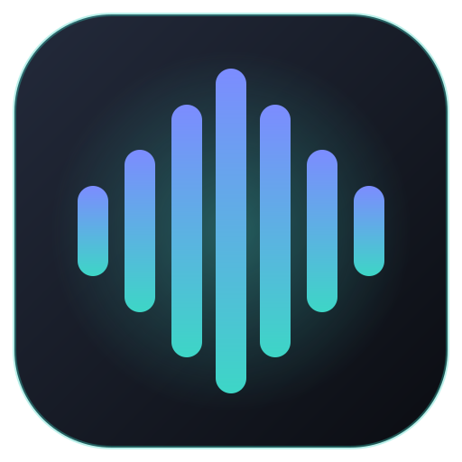
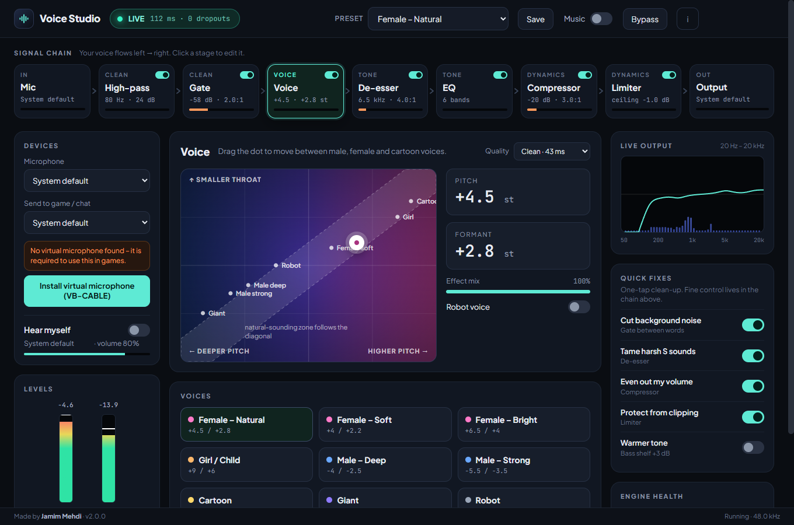
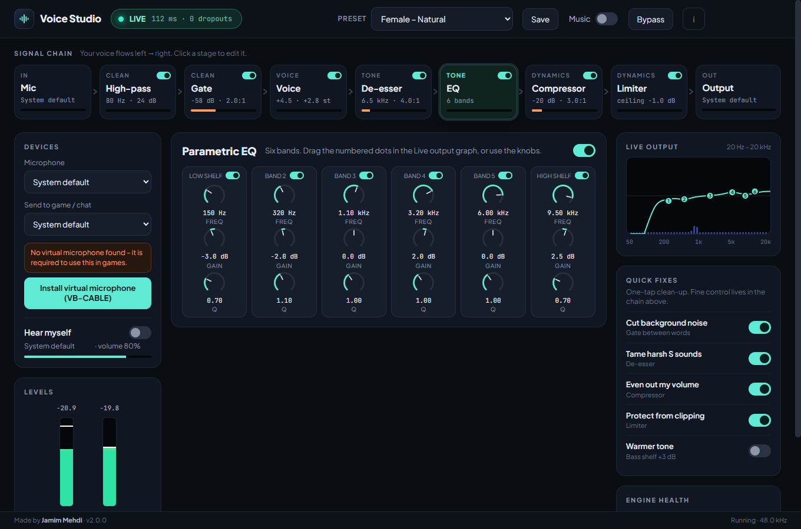
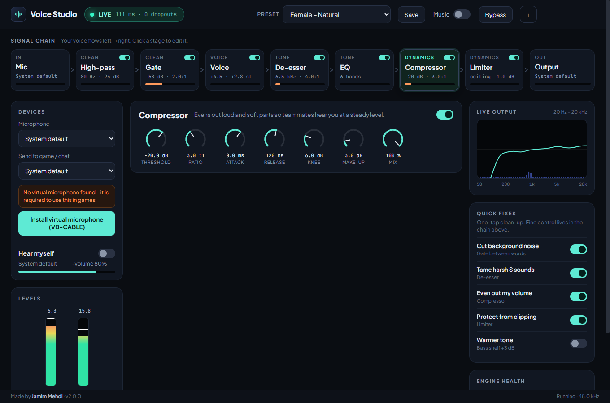
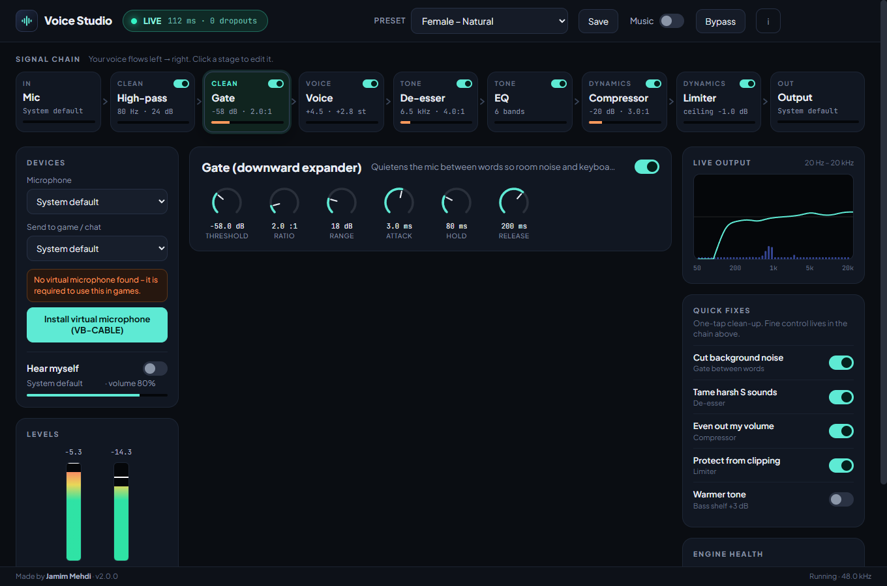
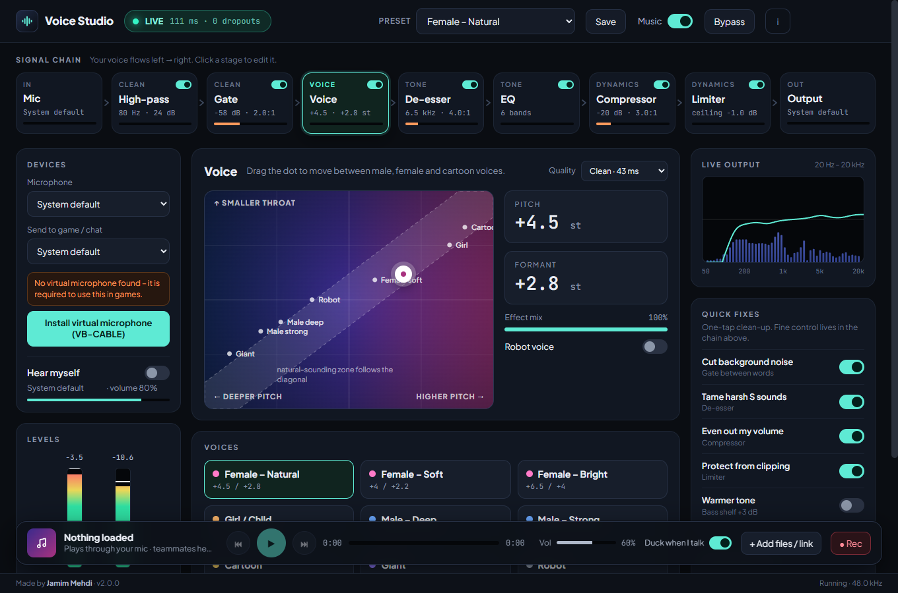
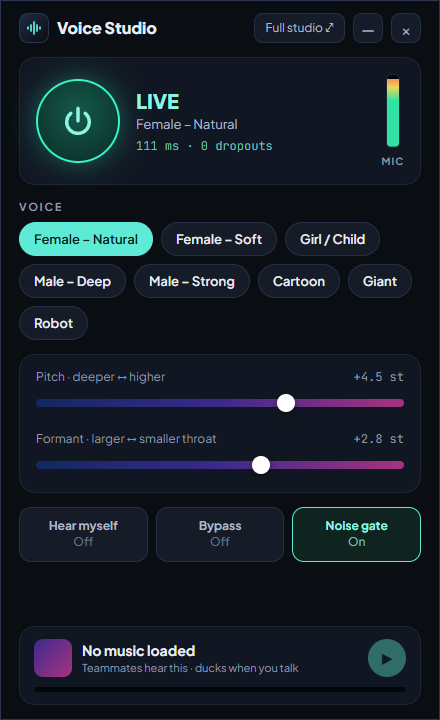
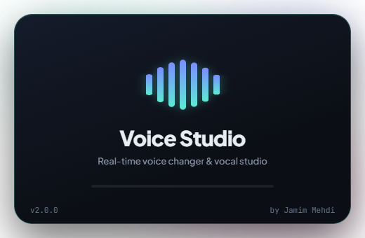

<p align="center"></p>
<h1 align="center">Voice Studio</h1>
<p align="center">
  Real-time voice changer and vocal studio for Windows.<br>
  Female, male and cartoon voices, routed live into Valorant, Discord and OBS.
</p>
<p align="center">
  <a href="https://github.com/jamimmehdi/voice-studio/releases/latest"><b>Download</b></a> ·
  <a href="https://jamimmehdi.github.io/voice-studio/">Website</a> ·
  <a href="#game-and-app-setup">Game setup</a> ·
  <a href="#troubleshooting">Troubleshooting</a>
</p>

<p align="center"></p>

**Designed and developed by [Jamim Mehdi](https://github.com/jamimmehdi).**

## Contents

[Features](#features) · [Install](#install) · [Game and app setup](#game-and-app-setup) · [Compact mode](#compact-mode) ·
[Music player](#music-player) · [Troubleshooting](#troubleshooting) · [Architecture](#architecture) · [Develop](#develop)

## Features

| | |
| --- | --- |
| **Voice pad** | One draggable dot moves between male, female and cartoon voices. Pitch and formant are independent (phase vocoder with cepstral formant control). |
| **Ten built-in voices** | Female natural / soft / bright, Girl, Male deep / strong, Cartoon, Giant, Robot, Broadcast. Save your own presets. |
| **Studio chain** | High-pass, downward expander (gate), split-band de-esser, 6-band parametric EQ with a draggable curve, compressor, look-ahead limiter, input / output gain. |
| **Quality modes** | 512 / 1024 / 2048-sample frames. The default, 2048 (about 43 ms), is the cleanest. |
| **Music through the mic** | Local files, playlist or a link. Ducks while you talk. Teammates hear it. |
| **Compact mode** | Tray icon, global shortcut (default `Ctrl+Alt+V`), an always-on-top panel that never steals focus, and a floating icon. |
| **Live scope and meters** | Spectrum, level meters and a gain-reduction meter per dynamics stage. |
| **Recorder** | Saves a WAV of exactly what your teammates hear. |
| **Auto-updates** | Checks GitHub Releases on launch; one click installs. |
| **One-click virtual mic** | Downloads and starts the official VB-CABLE installer, after verifying its signature. |

### Screenshots

| EQ – drag bands on the spectrum | Compressor – with gain-reduction meter |
| --- | --- |
|  |  |

| Gate | Music player dock |
| --- | --- |
|  |  |

| Compact panel | Floating icon | Launch screen |
| --- | --- | --- |
|  |  |  |

## Install

1. Download `Voice-Studio-Setup-x.y.z.exe` from the [latest release](https://github.com/jamimmehdi/voice-studio/releases/latest) and run it.
   Windows SmartScreen may warn about an "unknown publisher" because the installer is not code-signed. Choose **More info → Run anyway**.
2. Games can only use real input devices, so you need a virtual microphone. If none is found, click
   **Install virtual microphone (VB-CABLE)** in the Devices card. It downloads the official package from vb-audio.com,
   checks its signature and starts VB-Audio's installer. Click **Install Driver**, then **restart your PC**.
3. In Voice Studio set **Send to game / chat** to **`CABLE Input`**, click **Start engine** and pick a voice.
4. In your game or chat app choose **`CABLE Output (VB-Audio Virtual Cable)`** as the microphone (see below).

```
Your mic  →  Voice Studio  →  CABLE Input  →  CABLE Output  →  Game / Discord / OBS
```

VB-CABLE is donationware by VB-Audio (<https://vb-audio.com/Cable/>). Its licence does not allow bundling it inside
another installer, so it is **not** included – the app only downloads it from the official site on request.

To hear yourself, turn on **Hear myself** and pick your **headphones** as the monitor device. Don't monitor through speakers: the mic will pick them up.

## Game and app setup

Pick **`CABLE Output (VB-Audio Virtual Cable)`** as the input device. Menu names vary between game versions; if you
can't find the option, search the settings for "microphone" or "voice".

### Valorant

1. Voice Studio: output **CABLE Input**, **Start engine**.
2. Valorant: **Settings → Audio → Voice Chat → Input Device** → `CABLE Output (VB-Audio Virtual Cable)`.
3. Use the in-game voice test to confirm you hear the changed voice.

Voice Studio is a plain audio device. It never injects into the game or touches its memory, so Vanguard sees nothing unusual.

### Discord

1. **User Settings → Voice & Video → Input Device** → `CABLE Output (VB-Audio Virtual Cable)`.
2. Switch Discord's **Noise Suppression**, **Echo Cancellation** and **Automatic Gain Control** off – Voice Studio already cleans and levels the signal, and doing it twice smears the voice.
3. Leave **Automatic Input Sensitivity** on.

### CS2, Apex Legends, Fortnite, Call of Duty and similar

Open the game's **Audio / Voice chat** settings and set the **Microphone** or **Voice input device** to `CABLE Output`.
If the game has no device picker it follows the Windows default recording device – use the Windows method below.

### OBS, Streamlabs and streaming

1. Add an **Audio Input Capture** source and choose `CABLE Output (VB-Audio Virtual Cable)`.
2. Remove any other microphone from the mixer so your real voice isn't sent as well.
3. Music from the music player travels through the same virtual mic, so it will be on stream too.

### Windows default, Teams, Zoom, Google Meet

1. **Settings → System → Sound → Input**, pick `CABLE Output` as the default input device.
2. In Teams / Zoom / Meet choose the same device, or leave it on "Default".
3. Switch the default back to your headset when you stop using Voice Studio.

## Compact mode

Close or minimise the main window and Voice Studio keeps running in the tray. Press `Ctrl+Alt+V` (configurable in
**About → Shortcut**) to show the compact panel on top of your game. It never takes keyboard focus. Shrink it to a floating
icon; click the icon to bring the panel back.

Overlays show over **borderless and windowed-fullscreen** games. Exclusive fullscreen hides all overlays, so switch the game to borderless.

## Music player

Switch **Music** on in the top bar to show the player. Add local files, or paste a link and press **Add files / link**.
Tracks play through your mic path: you hear them in your headphones and teammates hear them too. **Duck when I talk**
lowers the music while you speak.

## Troubleshooting

| Problem | Fix |
| --- | --- |
| No `CABLE` device listed | Run the VB-CABLE installer from the Devices card, click **Install Driver**, restart the PC. |
| Teammates can't hear me | Output must be **CABLE Input**, the **LIVE** pill must be on, and the game's input must be **CABLE Output**. |
| I hear nothing in my headphones | Turn on **Hear myself** and choose your headphones as the monitor device. |
| Voice sounds choppy or robotic | Set **Quality** to **Clean**, raise **Audio buffer** in Engine health and keep large pitch moves within about ±6 st, using formant for the rest. |
| Dropouts counter keeps rising | Raise the audio buffer; close heavy apps; use a 48 kHz device. |
| Compact panel hidden in game | Switch the game from exclusive fullscreen to borderless / windowed. |
| Shortcut does nothing | Another app may own the combination. Pick a different one in **About**. |
| A link won't load | Some age-restricted videos can't be fetched. Download the audio elsewhere and use **Add files**. |

## Architecture

TypeScript (strict) + React 19 + Zustand, built with `electron-vite`. Layers depend only downwards:

```
src/
  shared/      pure domain code used by every process: parameters, presets, persisted-state migration,
               IPC contract, protocols, formatting, stage definitions
  engine/      the audio engine – no React, no Electron
    dsp/         biquad, FFT, pitch shifter, expander, de-esser, compressor, limiter, VoiceChain
    worklet/     AudioWorklet processor (ProcessorCore is framework-free and unit tested)
    audio/       AudioEngine (Web Audio graph), MusicBus, MusicPlayer, Playlist, ducking, devices, WAV, meters
  main/        Electron main process, one small injectable module per concern
               (settings, shortcut, tray, overlay controller, relay, updater, yt-dlp, VB-CABLE, windows, IPC)
  preload/     contextBridge APIs (typed by shared/ipc)
  renderer/
    ui/          design-system primitives (Knob, Switch, BarSlider, Modal, …) with CSS Modules
    lib/         pure UI maths (knob, voice pad, scope)
    studio/      the main window: store, controller (application service), remote bridge, components
    quick/       compact panel      icon/   floating icon
tests/         engine · main · shared · renderer (jsdom + Testing Library)
scripts/       worklet bundler, end-to-end test, screenshot capture
docs/          landing page (GitHub Pages) and screenshots
```

Key decisions:

- **The DSP is plain TypeScript with no browser dependencies**, so it runs in the AudioWorklet and in Node unit tests alike.
- **One store per window, one controller per window.** Components never talk to Web Audio or IPC directly.
- **Meters bypass React**: a timer-driven `MeterHub` writes straight to the DOM, so 30 fps level updates cause no re-renders (and keep running while the window is hidden in the tray).
- **Main-process services take their dependencies as constructor arguments** (file I/O, Electron globals, downloaders), which is why they are unit tested without Electron.
- The compact panel and floating icon are separate windows that **relay commands to the engine window** through the main process.

## Develop

```bash
npm install
npm run dev          # build the worklet, then run electron-vite with HMR
npm run typecheck    # tsc for main/preload/shared and for renderer/engine
npm run lint
npm test             # 360+ unit and component tests
npm run test:coverage
npm run build        # typecheck + worklet + electron-vite build  -> out/
npm run test:e2e     # launches the built app (run `npm run build` first)
npm run dist         # Windows installer -> dist/
```

### Releasing

1. Bump `version` in `package.json`.
2. `npm run dist`
3. Create a GitHub release tagged `v<version>` and upload `dist/Voice-Studio-Setup-<version>.exe`, its `.blockmap`
   and `dist/latest.yml`. Installed apps check this release on launch and show **↑ Update**.

## Credits

- **Jamim Mehdi** – author
- **VB-Audio / Vincent Burel** – VB-CABLE virtual audio cable
- **yt-dlp** – link audio extraction (downloaded on first use)
- **Plus Jakarta Sans**, **JetBrains Mono** – typefaces (SIL Open Font License)
- **Electron**, **React**, **Zustand**, **electron-updater**

## Licence

MIT © 2026 Jamim Mehdi
